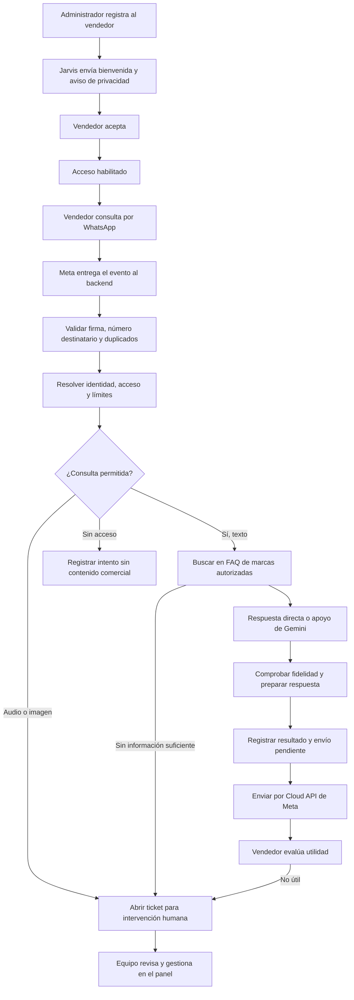

# Mapeo general de Jarvis

Fecha: 6 de noviembre de 2026. Revisión del checkout local de AgenteWPP.

## 1. Conclusión

La intención descrita por el equipo coincide con el proyecto: Jarvis es un asistente para apoyar a vendedores y responsables comerciales de Positive Company dentro de WhatsApp. Responde sobre marcas y productos usando información curada, restringe el acceso y registra las preguntas que requieren intervención humana.

El proyecto tiene un piloto inicial y una implementación posterior considerablemente más completa. Todavía no equivale a toda la visión del producto ni hay evidencia suficiente en esta revisión para declararlo operativo en producción. Incorporar el número propio es una dependencia del canal, pero no completa por sí solo las funciones comerciales pendientes.

El bloqueo actual de alta del número **no tiene una causa comprobada**. El repositorio registra dificultades históricas con credenciales y cuentas de Meta, pero no contiene el error actual ni permite conocer el estado actual de los activos en Meta.

## 2. Qué se considera evidencia

- **Comprobado ahora:** código presente, configuración efectiva validada localmente sin publicar credenciales, remoto Git configurado y 240 pruebas seleccionadas aprobadas.
- **Registrado históricamente:** pruebas reales en celulares y decisiones documentadas hasta el 29 de octubre de 2026. No se volvieron a ejecutar los envíos reales.
- **Planeado:** requisitos del PRD que no tienen una implementación conectada identificable en el flujo actual.
- **Pendiente de verificar:** Meta, número nuevo, permisos y vigencia del token, contenido real del banco, despliegue, DNS y operación del servidor.

No se modificaron credenciales, cuentas de Meta, datos comerciales ni servicios desplegados. No se enviaron mensajes por WhatsApp ni se hicieron llamadas reales a Gemini.

## 3. Qué problema pretende resolver

El vendedor necesita respuestas rápidas durante sus visitas: características de producto, ingredientes, argumentos, precios y materiales vigentes. Jarvis pretende reducir consultas repetidas a marca, trade y comercial, y convertir las dudas sin respuesta en una lista de trabajo visible.

El PRD define vendedores, gestores, ejecutivos, administradores y determinados socios externos autorizados. No está diseñado para atender directamente a compradores o consumidores finales, negociar condiciones ni tomar pedidos. Tampoco se ha implementado un agente que ejecute libremente acciones sobre todos los sistemas de la empresa.

Fuente: [PRD, visión y usuarios](prd.md), especialmente secciones 1–5 y las decisiones posteriores de la sección 10.

## 4. Flujo reconstruido

### Alta y acceso

El administrador registra a la persona con teléfono, perfil, empresa, marcas, estados, canales y gestor. El sistema prepara una bienvenida mediante una plantilla de Meta y registra el consentimiento. Los estados incluyen pendiente de aceptación, activo, rechazado y revocado.

El código actual guarda silencio frente a desconocidos y registra el intento. Esto sustituye la respuesta fija descrita en una sección antigua del PRD; la decisión posterior aparece en su sección 10. La identidad contempla teléfono y BSUID, aunque aún hay una tarea antigua abierta sobre ese tema en `STATE.md`.

### Entrada y decisión

Meta llama a `POST /webhook/whatsapp`. El backend valida límites de entrada, tamaño, firma y destinatario. Compara el identificador del número receptor con el configurado: un número nuevo mal reflejado en la configuración puede provocar que descarte eventos, aunque esto no explica por sí mismo un fallo de alta en Meta.

Cada mensaje tiene un identificador para evitar repetir efectos. Después se comprueban identidad, acceso y límite de mensajes. Las preguntas de texto autorizadas se procesan fuera de la transacción de entrada. Audio e imagen se escalan; no hay transcripción ni análisis visual conectados.

### Conocimiento y respuesta

La fuente conectada es `FaqSource`, que lee `content.faq_items` en PostgreSQL. Recupera ítems activos de marcas permitidas y contenido general, y los ordena por coincidencia de palabras. No se encontró una búsqueda vectorial conectada al flujo actual.

Una coincidencia alta puede responder directamente. En otros casos Gemini ayuda a seleccionar o redactar usando los candidatos recuperados y una ventana breve de conversación. Hay comprobaciones deterministas de fidelidad; si no hay sustento, se escala. El diseño incluye presupuesto mensual y reserva por palabras ante determinadas fallas de IA.

La búsqueda actual se filtra por **marca**. Aunque el contexto del usuario contiene perfil, UF y canal, la fuente FAQ no implementa el motor completo de autorización y consulta de precios por esas dimensiones descrito en el PRD.

### Envío y seguimiento

El sistema registra salidas en una cola persistida en PostgreSQL antes de enviarlas. Distingue fallas definitivas, transitorias y resultados ambiguos para gestionar envíos y evitar duplicados. Guarda trazas, tickets y evaluaciones de utilidad.

El panel permite revisar conversaciones, gestionar tickets, personas, FAQ, métricas y alertas. **Concluir un ticket solo cambia su estado:** no manda la respuesta humana al vendedor. El Inbox tampoco contiene un editor para contestar por WhatsApp. El circuito de devolución humana necesita definirse y comprobarse operativamente.

## 5. Componentes y conexiones

| Componente | Función | Evidencia y alcance |
|---|---|---|
| `piloto/` | Prueba inicial en Node.js, sin IA | Documentado como descartable; endpoint `/webhook` |
| `backend/` | Aplicación actual en Python/FastAPI | Webhook, acceso, cerebro, panel y tareas de fondo; endpoint `/webhook/whatsapp` |
| `frontend/` | Interfaz administrativa | Plantillas servidas por el backend; HTMX, Alpine y Tailwind |
| PostgreSQL | Datos y cola persistida | Esquemas `access`, `chat`, `content`, `ops` y vistas `assistant` |
| WhatsApp Cloud API | Comunicación con vendedores | Integración oficial directa con Meta |
| Gemini | Apoyo para respuestas y asistente del panel | Cliente de API directa; vigencia de modelo y disponibilidad no verificadas mediante llamada real |
| IAM corporativo | Identificación en el panel | Integración presente; configuración local usa modo de desarrollo |
| Resend | Alertas por correo | Implementado; sin configuración suficiente en el entorno local revisado |
| WAHA | Avisos internos al equipo | Implementado como canal auxiliar; configuración inicial deshabilitada localmente; el estado operativo también depende del banco |
| DigitalOcean, nginx y PM2 | Alojamiento previsto | Decisión documentada; despliegue actual no comprobado |

Hay dos usos distintos de IA: el cerebro que responde al vendedor y el asistente interno del panel. Este último consulta vistas de lectura; sus herramientas no modifican datos ni envían mensajes.

## 6. Implementación frente a visión original

| Capacidad | Resultado de la revisión |
|---|---|
| Acceso restringido y consentimiento | Implementación presente |
| Consulta de FAQ con apoyo de IA | Implementación conectada al backend |
| Evaluación útil/no útil y escalamiento | Implementación presente |
| Gestión de personas, FAQ, conversaciones y tickets | Panel presente |
| Precios por SKU, canal, UF, perfil y vigencia | No se identificó un motor conectado; responder un valor presente en una FAQ no equivale a esta capacidad |
| Cálculo comercial de margen | El flujo actual trata consultas de cálculo como escalamiento |
| Sincronización/publicación desde Google Drive | No se identificó integración operativa en el backend |
| ERP/Aquífero, stock, pedidos y clientes | Integración no identificada; Aquífero figura como fase posterior |
| Entrega nativa de fichas, fotos y certificados | El adaptador actual ofrece texto, plantillas y botones; no implementa envío de archivos |
| Planogramas, mix, kits de cadastro y marcas de agua | Requisitos/documentación; no se identificó el circuito completo implementado |
| Audio e imagen comprendidos automáticamente | No; se escalan |
| Respuesta humana desde Inbox | No implementada en ese panel |
| Edición completa de una persona existente | La documentación registra la lacuna; hay alta, revocación y otras operaciones específicas |

Los CSV de `docs/planilhas/` son modelos de carga, no evidencia de una integración funcionando. La FAQ inicial contempla un guía de 112 preguntas, pero no se pudo comprobar cuántas están cargadas o vigentes en el banco actual.

## 7. Estado local comprobado

- La configuración efectiva pasa sus validaciones de aplicación y panel.
- `PRODUCTION=false`, `BRAIN_ENABLED=true` y `PANEL_ENABLED=true`.
- Existen valores configurados para credenciales de WhatsApp, identificador de número, Gemini y conexión del asistente. **Presencia no significa vigencia ni permisos correctos.**
- Está configurado el nombre de plantilla `jarvis_boas_vindas`; su aprobación en la cuenta de destino no fue comprobada.
- La configuración inicial del grupo de equipo está deshabilitada; correo de alertas sin configurar.
- Hay remoto GitHub y un archivo de CI. No se verificó la ejecución ni el resultado del CI remoto.
- Se ejecutaron 240 pruebas seleccionadas: todas aprobaron, en configuración, acceso, lectura de mensajes, coincidencia y fidelidad.
- Una ejecución más amplia con pruebas asíncronas no terminó y se interrumpió. Una consulta de solo lectura al banco tampoco concluyó y se interrumpió. No se atribuye una causa a esas limitaciones ni se declaran validadas las integraciones.

El informe histórico del 29 de octubre registra pruebas reales por celular, respuestas con botones y un gate de IA aprobado. También registra que un token temporal venció con error 190. Son antecedentes, no una comprobación del funcionamiento actual.

## 8. Dónde está el bloqueo de Meta

Conviene separar cinco elementos:

| Elemento | Qué representa | Qué falta comprobar |
|---|---|---|
| Portafolio empresarial | Organización propietaria de los activos | Propietario y acceso del administrador |
| App de Meta | Aplicación que usa la API y recibe eventos | Identidad de la app y permisos asignados |
| WABA | Cuenta de WhatsApp Business Platform | Cuenta propia del proyecto y asociación con la app |
| Número / `phone_number_id` | Línea visible y objeto técnico de Meta | Alta, verificación, registro y correspondencia del ID configurado |
| Token y webhook | Autorización de llamadas y recepción de eventos | Vigencia, acceso al activo, suscripción y URL correcta |

La documentación oficial de Meta en su colección de Postman distingue la consulta de números de una WABA, el registro del número y la suscripción de la app como operaciones separadas. El código de Jarvis utiliza un número ya preparado; no contiene un flujo propio de incorporación que ejecute estas operaciones.

Fuente externa consultada: [colección oficial de Meta, WhatsApp Cloud API](https://www.postman.com/meta/whatsapp-business-platform/documentation/wlk6lh4/whatsapp-cloud-api?entity=request-13382743-6909d472-3637-41d8-a338-c2fc14485f26). La página directa de registro de Meta devolvió HTTP 429 durante esta revisión.

Los documentos históricos indican que se decidió usar una cuenta y un número propios para Jarvis, separados de una cuenta comercial existente de Positive Co. También registran una asociación equivocada que posteriormente se habría retirado. No se comprobó el estado actual ni debe asumirse que aquella cuenta existente es de pruebas.

**Dato decisivo pendiente:** texto/código del error actual y paso exacto en que aparece. Un error al agregar la línea, uno al recibir el código y uno al registrar el objeto de API son problemas distintos. El error 190 documentado ocurrió al enviar con un token vencido; no demuestra la causa del bloqueo de alta.

## 9. Orden de continuación propuesto

0. **Resuelto por el usuario:** el número será exclusivo de Jarvis mediante la API; no se necesita atención desde la aplicación del teléfono. Véase la sección 12.
1. Identificar el error actual y los activos afectados: app, WABA y número. Registrar estados sin copiar credenciales.
2. Comprobar acceso del token a esos activos y correspondencia entre número visible e identificador técnico. Empezar con lecturas.
3. Según el resultado, resolver el paso preciso de alta/verificación/registro o la asignación de permisos.
4. Confirmar recepción del webhook en el backend actual; evitar confundir la ruta del piloto con la del backend.
5. Probar un recorrido completo con una persona autorizada: bienvenida, consentimiento, pregunta, respuesta, evaluación y ticket sin respuesta.
6. Verificar atención humana y notificaciones; hoy no basta con concluir el ticket para contestar al vendedor.
7. Revisar despliegue, permisos de tablas, DNS, login y comprobaciones en las versiones previstas para producción.
8. Priorizar con comercial las siguientes fuentes estructuradas e integraciones. El nuevo número habilita el canal, pero no aporta esas fuentes.

## 10. Lecturas clave y divergencias documentales

- [PRD](prd.md): propósito y alcance; leer las decisiones posteriores a las secciones originales.
- [Decisiones de arquitectura](architecture/overview.md): los ADR sustituyen TypeScript/GCP/Vertex del diseño inicial por Python/FastAPI/DigitalOcean y API directa de Gemini. Varias secciones iniciales de esa página siguen siendo plantillas.
- [Estado de ingeniería](STATE.md): antecedentes y pendientes. Incluye notas superadas: falta de remoto y de credenciales locales, entre otras. No debe tratarse como inventario actual sin contrastarlo.
- [Prueba real histórica](tasks/cerebro.1/gate-ia-relatorio.md): resultados registrados del 29 de octubre y fallo del token temporal.
- [Montaje del backend](../backend/app/main.py): selección del cerebro y unión de servicios.
- [Entrada de Meta](../backend/app/api/webhook.py) y [control por mensaje](../backend/app/services/pipeline.py).
- [Cerebro](../backend/app/services/brain/provider.py), [fuente FAQ](../backend/app/services/brain/faq_source.py) y [cliente de WhatsApp](../backend/app/services/whatsapp.py).
- [Gestión de tickets](../backend/app/panel/services/tickets_admin.py) e [Inbox](../backend/app/panel/api/inbox_chat.py): límites de la intervención humana.

Este mapa es una fotografía de lo revisado. No reemplaza las decisiones originales ni constituye aprobación de producción.

## 11. Aclaración del usuario y definición de la operación

El usuario informa que el número fue adquirido nuevo, se destina al proyecto y ya está asociado con WhatsApp Business y Meta. Esto es información declarada; no se ha inspeccionado la cuenta. Falta distinguir si «WhatsApp Business» es la aplicación instalada en el teléfono y en qué sección de Meta aparece el número. Una línea recién adquirida puede tener ya una cuenta activa por haber sido registrada después de su adquisición.

La primera decisión de operación tenía dos rutas; el usuario eligió la primera (sección 12):

| Ruta | Uso previsto | Implicación para Jarvis |
|---|---|---|
| Número dedicado a la API | El agente atiende por Cloud API; la intervención humana se resuelve mediante una interfaz o procedimiento definido | Coincide con el canal implementado, pero falta resolver la devolución humana porque el panel actual no envía respuestas |
| Aplicación y API con el mismo número | El equipo desea conservar atención manual desde el teléfono además del agente | Evaluar coexistencia y elegibilidad del flujo disponible; revisar cómo se pausará el agente y se tratarán los eventos de intervención humana |

Meta anunció el uso simultáneo de Business App y Business Platform con el mismo número. Esto confirma que existe esa modalidad; no demuestra que esté habilitada para esta cuenta ni que el Jarvis actual la soporte sin ajustes. Fuente: [anuncio oficial de Meta de septiembre de 2025](https://about.fb.com/news/2025/09/bringing-new-tools-to-help-businesses-boost-engagement-customer-support-and-discoverability/).

El orden de trabajo es: definir la ruta de operación; inventariar en lectura los activos existentes; preparar un recorrido de pruebas con el número propio; comprobar atención automática y humana; completar fuentes de conocimiento y condiciones de despliegue. Cambiar el registro o desvincular una cuenta no es un paso automático del diagnóstico.

## 12. Decisión confirmada: número exclusivo para Jarvis

El usuario confirma: «Será exclusivo para Jarvis; no necesitamos atender desde el teléfono».

**Objetivo de conexión:** vendedor → número de Jarvis en WhatsApp → Cloud API de Meta → backend de Jarvis → FAQ/IA → respuesta por Cloud API. El equipo administra contenidos y casos mediante el panel. La coexistencia con la aplicación del teléfono queda fuera de esta ruta elegida.

### Secuencia concreta de habilitación

1. **Inventario en Meta.** Identificar el portafolio empresarial propietario, la app Jarvis, la WABA destinada al proyecto y si el número propio ya está listado en WhatsApp Manager. Anotar el estado exacto, la existencia del `phone_number_id` y el resultado de la verificación de la línea. No confundir una asociación en otras pantallas de Meta con un registro operativo en Cloud API.
2. **Situación de la aplicación móvil.** Comprobar si sigue existiendo una cuenta activa en WhatsApp Business del teléfono. Si el flujo de incorporación elegido exige liberarla, preparar esa transición conociendo su efecto antes de ejecutarla. La decisión de uso exclusivo define el destino; por sí sola no demuestra qué transición necesita el estado actual.
3. **Preparación del canal.** Completar los pasos de incorporación que falten según el inventario; comprobar que el token de operación acceda a la app y al activo correctos. Diferenciar la verificación de titularidad por código del registro técnico del número en la API.
4. **Recepción de eventos.** Configurar el webhook del backend actual (`/webhook/whatsapp`), completar su verificación, suscribir los eventos de mensajes y comprobar la suscripción de la app a la WABA. El token de verificación del webhook, el token de acceso y el secreto de la app cumplen funciones distintas.
5. **Configuración de Jarvis.** Reflejar el `phone_number_id` del número propio y las credenciales correspondientes; comprobar que la plantilla de bienvenida esté disponible y aprobada en la WABA elegida. Las credenciales del piloto y del backend son configuraciones separadas.
6. **Piloto controlado.** Probar con una persona autorizada: bienvenida → consentimiento → consulta con respuesta → consulta sin respuesta → ticket → evaluación. Probar también un remitente sin acceso y comprobar el resultado del envío, no solo la aceptación de la petición por Meta.
7. **Operación y despliegue.** Definir responsable y procedimiento de retorno al vendedor en los casos escalados. El panel actual no permite responder: habrá que acordar un canal humano separado o especificar una función de respuesta desde el panel. Completar además despliegue, permisos de banco, dominio y login antes de producción.

Meta documenta por separado la consulta de números de la WABA, el registro del número, la suscripción de la app y el envío de mensajes: [referencia oficial de Cloud API](https://www.postman.com/meta/whatsapp-business-platform/documentation/wlk6lh4/whatsapp-cloud-api?entity=request-13382743-6909d472-3637-41d8-a338-c2fc14485f26).

**Próxima comprobación:** estado del número propio en WhatsApp Manager y cuenta de destino. Aún no se ha inspeccionado esa pantalla ni se ha ejecutado un alta, eliminación o migración.
